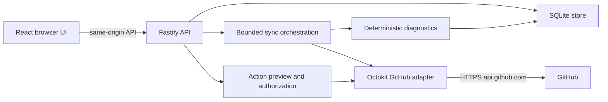

# Architecture

GitNostics is a single-user, self-hosted application. A React/Vite frontend talks to a Fastify API. The API owns GitHub credentials, bounded synchronization, diagnostic evaluation, SQLite persistence, and approved actions. There is no required cloud service, AI provider, or telemetry.

## Ownership boundaries

| Location               | Responsibility                                                                                                                                    |
| ---------------------- | ------------------------------------------------------------------------------------------------------------------------------------------------- |
| `packages/shared`      | Validated public contracts, modes, settings, findings, action types, future provider interfaces.                                                  |
| `packages/github`      | Installation authentication, response mapping, transport/retries, permitted GitHub destinations and bounded downloads. No browser access.         |
| `packages/diagnostics` | Pure evidence-based rules, classification/fingerprints, drift, retention recommendations, transparent metrics. No network or database dependency. |
| `apps/server/src/db`   | Embedded additive migrations, persistence, lifecycle/deduplication, retention, durable task records, consistent backups.                          |
| `apps/server`          | Environment validation, HTTP security gates, synchronization orchestration, connection status, API, graceful shutdown, static hosting.            |
| `apps/web`             | Navigation, repository and evidence views, preferences, responsive UI, explicit demo/live presentation, reviewable action dialogs.                |
| `tests`                | Sanitized/synthetic fixtures, HTTP integration, browser verification. GitHub writes are prohibited.                                               |

Root tooling owns dependency versions and shared build/test configuration. Internal packages remain narrow modules; production builds bundle internal TypeScript and retain external npm runtime dependencies.

## Data and provenance

Every persisted domain record is keyed by `demo` or `live`. A mode switch selects an independent dataset; it does not relabel fixture evidence as real data. Repository records carry `syncedAt`, status, and errors. Snapshot warnings indicate inaccessible or incomplete sources. Findings store rule identity/version, fingerprint, evidence, confidence, timestamps, and lifecycle status.

Repeated findings update their existing fingerprint. Acknowledgment and suppression survive continued observation. Resolution must depend on successful authoritative observation, not an empty payload caused by denied permission or failed synchronization. A later recurrence reopens the record with its history retained.

Configuration comparisons use explicitly saved baselines. Unknown or inaccessible values are excluded from asserted regressions. Workflow analytics cover downloaded run/job samples; artifact snapshots measure retained metadata at observation time. No score should imply a more comprehensive assessment than its stated calculation.

## Persistence and scheduling

SQLite uses WAL, foreign keys, a busy timeout, and ordered embedded migrations. The process creates the data directory before opening the database. Migration versions are recorded; future changes append a migration rather than altering a shipped version. Restart recovery marks interrupted tasks and leaves repository problems visible.

Manual/configured polling uses bounded work and avoids conflicting duplicate synchronization. A repository failure must not block other repositories. Transient errors respect retry headers and backoff; cached data remains available with observation time and warnings. The API must remain responsive while network work is active. Graceful shutdown aborts supported network work and closes the store.

Retention removes old resolved findings, notifications, audit/storage history, and terminal tasks under each mode's configured limits. Current monitored snapshots and unresolved findings remain until explicitly removed/resolved. Hard per-mode caps retain 2,000 audit events, 500 notifications, 5,000 storage snapshots, and 10,000 resolved findings; these histories are bounded samples. Persisted excerpts must be redacted and bounded. SQLite online backup provides a consistent copy including WAL changes; never copy only the active `.sqlite` file as a backup. Automated/manual backups share a separate seven-file rotation and can contain older deleted repository metadata until rotated or removed locally.

## Security and extension points

Default binding is loopback; non-loopback requires an operator token. GitHub credentials stay in process configuration/key files, never browser responses or database exports. GitHub content is untrusted text. The frontend uses structured rendering rather than executing repository HTML.

Write execution is a separate path with server opt-in, authenticated operator, installation permission checks, expiring impact preview, explicit confirmation, and audit outcomes. Read-only configuration must not gain writes through a browser toggle. No generic proxy, arbitrary URL fetch, shell execution, automatic merging, repository deletion, or protection weakening is exposed.

The initial notification provider is in-app. AI and additional notification interfaces are future extension boundaries, disabled unless a concrete adapter and consent model exist. Webhooks are not implemented; adding them requires verified signatures, bounded payloads, replay handling, and idempotency before any endpoint is advertised.
